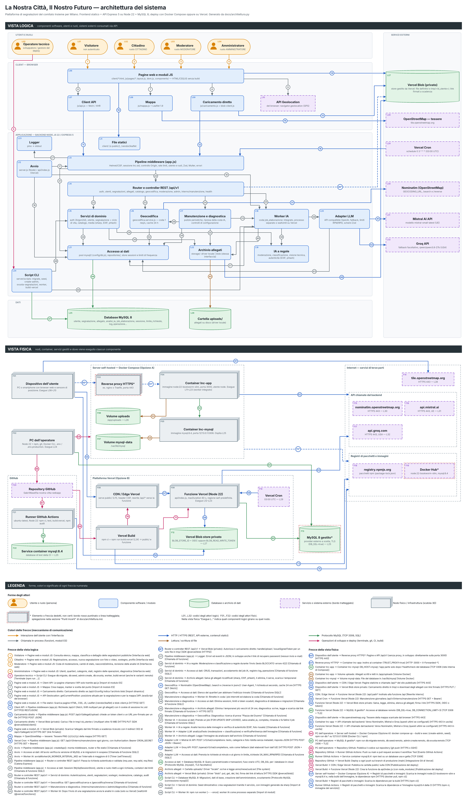

# Architettura di La Nostra Città

> Documento generato da [`architettura.py`](architettura.py) insieme all'immagine [`architettura.jpg`](architettura.jpg) (3600×6183 px). Per modificarli entrambi, aggiornare nodi e frecce nello script ed eseguire `python3 docs/architettura.py`.

La piattaforma è composta da un frontend statico (HTML, CSS e moduli JavaScript senza build), da un'API REST Express 5 su Node.js 22 e da un database MySQL 8. Gli allegati stanno su disco (cartella `uploads/`) oppure su Vercel Blob. Il sistema si può pubblicare in due modi alternativi: **Opzione A**, un server con Docker Compose (container `lnc-app` e `lnc-mysql`); **Opzione B**, Vercel (CDN per i file statici, una funzione serverless per l'API, Vercel Cron e Vercel Blob, con un MySQL gestito esterno). Le analisi IA girano in un worker che legge la coda `job_elaborazione`; il modello linguistico (Mistral, con Groq come riserva) è facoltativo.

L'immagine ha due sezioni, **Vista logica** e **Vista fisica**, e una legenda con forme, colori e l'elenco completo delle frecce. I codici `Lxx` e `Fxx` identificano gli attori logici e fisici. Gli elementi contrassegnati con `*` sono dedotti e spiegati in [Punti incerti](#punti-incerti).

| Forma | Tipo di attore |
|---|---|
| Rettangolo arrotondato arancione con icona | Utente o ruolo (persona) |
| Rettangolo arrotondato blu | Componente software / modulo |
| Cilindro verde | Database o archivio di dati |
| Rettangolo viola con bordo tratteggiato | Servizio o sistema esterno (bordo tratteggiato) |
| Scatola 3D grigia | Nodo fisico / infrastruttura (scatola 3D) |
| Cornice tratteggiata grigia | Raggruppamento di nodi fisici (host, piattaforma, Internet); può essere origine o destinazione di una freccia |

| Colore della freccia | Meccanismo |
|---|---|
| `#D98200` | Interazione dell'utente con l'interfaccia |
| `#1E5BC6` | HTTP / HTTPS (REST, API esterne, contenuti statici) |
| `#2E8B4F` | Protocollo MySQL (TCP 3306, SQL) |
| `#5F6B73` | Chiamata in-process (funzioni, moduli ES) |
| `#9C5A1E` | Lettura / scrittura di file |
| `#C2185B` | Operazioni di sviluppo e deploy (terminale, git, CI, build) |

## Frecce della vista logica

| N. | Origine | Destinazione | Protocollo / meccanismo | Descrizione | File di riferimento |
|---:|---|---|---|---|---|
| 1 | Visitatore (L01) | Pagine web e moduli JS (L06) | Interfaccia web | Consulta elenco, mappa, classifica e dettaglio delle segnalazioni pubbliche | `client/index.html`, `client/mappa.html`, `client/classifica.html`, `client/segnalazione.html` |
| 2 | Cittadino (L02) | Pagine web e moduli JS (L06) | Interfaccia web | Registrazione, accesso, nuova segnalazione con foto o video, sostegno, profilo | `client/registrazione.html`, `client/login.html`, `client/nuova-segnalazione.html`, `client/profilo.html` |
| 3 | Moderatore (L03) | Pagine web e moduli JS (L06) | Interfaccia web | Coda di moderazione, cambi di stato, nascondi/elimina, revisione delle analisi IA | `client/moderazione.html`, `client/js/pages/moderazione.js`, `client/js/pages/segnalazione.js` |
| 4 | Amministratore (L04) | Pagine web e moduli JS (L06) | Interfaccia web | Utenti, quartieri, categorie, stati, registro delle operazioni, diagnostica | `client/admin.html`, `client/js/pages/admin.js` |
| 5 | Operatore tecnico (L05) | Script CLI (L24) | Terminale (npm run …) | Esegue db:migrate, db:seed, admin:create, db:svuota, worker, build:vercel (anche le varianti :remoto) | `package.json (scripts)` |
| 6 | Pagine web e moduli JS (L06) | Client API (L07) | Import di modulo ES | Le pagine chiamano l'API solo tramite api.js | `client/js/pages/*.js`, `client/js/api.js` |
| 7 | Pagine web e moduli JS (L06) | Mappa (L08) | Import di modulo ES | Crea mappe, marker e scelta del punto | `client/js/pages/mappa.js`, `client/js/pages/nuova-segnalazione.js`, `client/js/mappa.js` |
| 8 | Pagine web e moduli JS (L06) | Caricamento diretto (L09) | Import dinamico | Caricamento diretto se /api/v1/config indica l'archivio blob | `client/js/pages/nuova-segnalazione.js`, `client/js/caricamento.js`, `server/src/routes/catalogo.routes.js` |
| 9 | Pagine web e moduli JS (L06) | API Geolocation (L10) | API JavaScript del browser | getCurrentPosition: posizione attuale per la segnalazione e per la mappa | `client/js/pages/nuova-segnalazione.js`, `client/js/mappa.js` |
| 10 | Pagine web e moduli JS (L06) | File statici (L11) | HTTP(S) GET | Scarica pagine HTML, CSS, JS, Leaflet (/vendor/leaflet) e blob-client.js | `server/src/app.js (express.static)`, `vercel.json`, `server/scripts/build-vercel.js` |
| 11 | Client API (L07) | Pipeline middleware (app.js) (L13) | HTTP(S) REST/JSON | Richieste /api/v1 (fetch; XHR multipart per gli allegati) con il cookie di sessione lnc.sid | `client/js/api.js`, `server/src/app.js` |
| 12 | Caricamento diretto (L09) | Pipeline middleware (app.js) (L13) | HTTP(S) POST JSON | POST /api/v1/allegati/upload: chiede un token client o un URL pre-firmato per un file | `client/js/caricamento.js`, `server/src/routes/segnalazioni.routes.js` |
| 13 | Caricamento diretto (L09) | Vercel Blob (privato) (L27) | HTTPS PUT (SDK @vercel/blob/client) | Carica i file in tmp/<id_utente>/ (multipart oltre 10 MB) | `client/js/caricamento.js`, `server/scripts/blob-client.entry.js` |
| 14 | Pagine web e moduli JS (L06) | Vercel Blob (privato) (L27) | HTTPS GET (link firmato) | Scarica l'allegato dal link firmato a scadenza ricevuto con il redirect 302 di /api/v1/allegati/:id | `server/src/storage/blobStorage.js (send)`, `vercel.json (CSP img-src, media-src)` |
| 15 | Mappa (L08) | OpenStreetMap — tessere (L28) | HTTPS GET | Tessere PNG {z}/{x}/{y} della mappa | `client/js/mappa.js (URL_TESSERE)` |
| 16 | Vercel Cron (L29) | Pipeline middleware (app.js) (L13) | HTTPS GET + Bearer | GET /api/v1/interno/manutenzione ogni giorno, con Authorization: Bearer CRON_SECRET | `vercel.json (crons)`, `server/src/controllers/interno.controller.js` |
| 17 | Avvio (L12) | Pipeline middleware (app.js) (L13) | Chiamata di funzione | createApp(): monta middleware, router e file statici | `server/src/server.js`, `api/index.js`, `server/src/app.js` |
| 18 | Avvio (L12) | Accesso ai dati (L21) | Chiamata di funzione (SQL) | All'avvio verifica la versione di MySQL e le migrazioni in sospeso | `server/src/server.js`, `server/src/config/migrazioni.js` |
| 19 | Avvio (L12) | Worker IA (L18) | Timer (setTimeout) | avviaWorker(AI_WORKER_INTERVAL_MS) se l'intervallo è maggiore di 0 | `server/src/server.js`, `server/src/ai/worker.js` |
| 20 | Pipeline middleware (app.js) (L13) | Router e controller REST /api/v1 (L14) | Catena Express | Passa la richiesta autenticata e validata (req.user, req.valid, req.files) | `server/src/app.js`, `server/src/routes/index.js` |
| 21 | Pipeline middleware (app.js) (L13) | Accesso ai dati (L21) | Chiamata di funzione (SQL) | Sessioni (MySqlSessionStore), utente e ruolo riletti a ogni richiesta, contatori dei limiti | `server/src/config/sessionStore.js`, `server/src/config/rateLimitStore.js`, `server/src/middlewares/auth.js`, `server/src/middlewares/security.js` |
| 22 | Router e controller REST /api/v1 (L14) | Servizi di dominio (L15) | Chiamata di funzione | Autenticazione, utenti, segnalazioni, sostegni, moderazione, catalogo, audit | `server/src/controllers/*.js` |
| 23 | Router e controller REST /api/v1 (L14) | Geocodifica (L16) | Chiamata di funzione | GET /geocodifica/cerca e /geocodifica/inversa | `server/src/routes/geocodifica.routes.js` |
| 24 | Router e controller REST /api/v1 (L14) | Manutenzione e diagnostica (L17) | Chiamata di funzione | /interno/manutenzione e /admin/diagnostica | `server/src/controllers/interno.controller.js`, `server/src/routes/admin.routes.js` |
| 25 | Router e controller REST /api/v1 (L14) | Worker IA (L18) | waitUntil (@vercel/functions) | Dopo l'invio di una segnalazione avvia le analisi in coda (solo su Vercel) | `server/src/controllers/segnalazione.controller.js`, `server/src/ai/worker.js` |
| 26\* | Router e controller REST /api/v1 (L14) | Vercel Blob (privato) (L27) | SDK @vercel/blob (HTTPS) | Autorizza il caricamento diretto: handleUpload / issueSignedToken per un solo file in tmp/ | `server/src/controllers/allegati.controller.js` |
| 27 | Pipeline middleware (app.js) (L13) | Logger (L23) | Chiamata di funzione | Errori ed eventi in JSON; in sviluppo anche il link di recupero password (nessun invio e-mail) | `server/src/middlewares/errorHandler.js`, `server/src/controllers/auth.controller.js`, `server/src/utils/logger.js` |
| 28 | Servizi di dominio (L15) | IA a regole (L19) | Chiamata di funzione | Moderazione e classificazione a regole durante l'invio (testo BLOCCATO: errore 422) | `server/src/services/segnalazione.service.js`, `server/src/ai/index.js` |
| 29 | Servizi di dominio (L15) | Accesso ai dati (L21) | Chiamata di funzione (SQL) | CRUD, transazioni, accodamento dei job IA, registro log_operazione | `server/src/services/*.service.js`, `server/src/repositories/*.js`, `server/src/utils/audit.js` |
| 30 | Servizi di dominio (L15) | Archivio allegati (L22) | Chiamata di funzione | Salva gli allegati ricodificati (sharp, EXIF, pHash), li elimina, li serve, scarica i temporanei | `server/src/services/media.service.js`, `server/src/services/segnalazione.service.js` |
| 31 | Geocodifica (L16) | Nominatim (OpenStreetMap) (L30) | HTTPS GET (fetch) | /search e /reverse in jsonv2: User-Agent, 1 richiesta al secondo, cache 24 ore | `server/src/services/geocodifica.service.js` |
| 32 | Geocodifica (L16) | Accesso ai dati (L21) | Chiamata di funzione (SQL) | Elenco dei quartieri per abbinare l'indirizzo trovato | `server/src/services/geocodifica.service.js` |
| 33 | Manutenzione e diagnostica (L17) | Worker IA (L18) | Chiamata di funzione | Rimette in coda i job interrotti ed elabora la coda | `server/src/services/manutenzione.service.js` |
| 34 | Manutenzione e diagnostica (L17) | Accesso ai dati (L21) | Chiamata di funzione (SQL) | Elimina sessioni, limiti e token scaduti; diagnostica di database e migrazioni | `server/src/services/manutenzione.service.js`, `server/src/services/diagnostica.service.js` |
| 35 | Manutenzione e diagnostica (L17) | Archivio allegati (L22) | Chiamata di funzione (+ HTTPS GET) | Elimina i temporanei più vecchi di 24 ore; diagnostica: scrive, legge e scarica dal link firmato | `server/src/services/manutenzione.service.js`, `server/src/services/diagnostica.service.js` |
| 36 | Manutenzione e diagnostica (L17) | Geocodifica (L16) | Chiamata di funzione | Diagnostica: ricerca di prova "Piazza del Duomo" | `server/src/services/diagnostica.service.js` |
| 37 | Worker IA (L18) | Accesso ai dati (L21) | Chiamata di funzione (SQL) | Prende un job (FOR UPDATE SKIP LOCKED), salva analisi_ia, completa, rimanda o fa fallire il job | `server/src/ai/worker.js`, `server/src/repositories/analisi.repository.js` |
| 38 | Worker IA (L18) | IA a regole (L19) | Chiamata di funzione | Analisi tecnica delle immagini e verifica di autenticità (EXIF, foto riusate) | `server/src/ai/worker.js`, `server/src/ai/visione.js`, `server/src/ai/autenticita.js` |
| 39 | Worker IA (L18) | Adapter LLM (L20) | Chiamata di funzione | analizzaTesto (moderazione + classificazione) e verificaPertinenza dell'immagine | `server/src/ai/worker.js`, `server/src/ai/providers/index.js` |
| 40 | Worker IA (L18) | Archivio allegati (L22) | Chiamata di funzione | Legge l'immagine da analizzare dall'archivio | `server/src/ai/worker.js` |
| 41 | Adapter LLM (L20) | Mistral AI API (L31) | HTTPS POST JSON + Bearer | POST /v1/chat/completions: testo, categorie e foto ridotta senza metadati; risposta JSON | `server/src/ai/providers/index.js`, `server/src/ai/providers/openaiCompatibile.js` |
| 42 | Adapter LLM (L20) | Groq API (L32) | HTTPS POST JSON + Bearer | POST /openai/v1/chat/completions, solo come fallback (dati elaborati fuori dall'UE) | `server/src/ai/providers/index.js` |
| 43 | Adapter LLM (L20) | Accesso ai dati (L21) | Chiamata di funzione (SQL) | Prenota le richieste al minuto e al giorno in limite_richieste (AI_MAX_RPM/RPD) | `server/src/ai/providers/limiti.js`, `server/src/config/rateLimitStore.js` |
| 44 | Accesso ai dati (L21) | Database MySQL 8 (L25) | Protocollo MySQL (mysql2), TLS facoltativo | Query parametrizzate e transazioni; fuso orario UTC; DB_SSL per i database in cloud | `server/src/config/db.js`, `server/src/config/dbOptions.js` |
| 45 | Archivio allegati (L22) | Cartella uploads/ (L26) | File system | Driver "locale": scrive e legge anno/mese/uuid.ext | `server/src/storage/localStorage.js` |
| 46 | Archivio allegati (L22) | Vercel Blob (privato) (L27) | HTTPS (SDK @vercel/blob) | Driver "blob": put, get, del, list; firma dei link di lettura | `server/src/storage/blobStorage.js` |
| 47 | Script CLI (L24) | Database MySQL 8 (L25) | Protocollo MySQL (connessione mysql2) | Migrazioni, dati di base, creazione dell'amministratore, svuotamento | `server/scripts/migrate.js`, `server/scripts/seed.js`, `server/scripts/create-admin.js`, `server/scripts/svuota-segnalazioni.js` |
| 48 | Script CLI (L24) | Servizi di dominio (L15) | Import di moduli | Seed dimostrativo: crea segnalazioni tramite il servizio, con immagini generate da sharp | `server/scripts/seed.js` |
| 49 | Script CLI (L24) | Worker IA (L18) | Import di moduli | npm run worker [-- --once]: worker IA come processo separato | `server/scripts/worker.js` |

## Frecce della vista fisica

| N. | Origine | Destinazione | Protocollo / meccanismo | Descrizione | File di riferimento |
|---:|---|---|---|---|---|
| 50\* | Dispositivo dell'utente (F01) | Reverse proxy HTTPS\* (F03) | HTTPS 443 | Pagine e API /api/v1 (senza proxy, in sviluppo: direttamente sulla porta 3000) | `README.md`, `docker-compose.yml (ports)` |
| 51\* | Reverse proxy HTTPS\* (F03) | Container lnc-app (F04) | HTTP :3000 + X-Forwarded-\* | Inoltro al container (TRUST_PROXY=true) | `.env.example`, `docker-compose.yml` |
| 52 | Container lnc-app (F04) | Container lnc-mysql (F05) | TCP 3306 (rete interna di Compose) | DB_HOST=mysql; l'app parte solo dopo l'healthcheck del database | `docker-compose.yml (depends_on, environment)` |
| 53 | Container lnc-app (F04) | Volume uploads (F06) | Volume Docker | Allegati scritti e letti in /app/uploads | `docker-compose.yml (volumes)`, `Dockerfile` |
| 54 | Container lnc-mysql (F05) | Volume mysql-data (F07) | Volume Docker | File del database in /var/lib/mysql | `docker-compose.yml (volumes)` |
| 55 | Dispositivo dell'utente (F01) | CDN / Edge Vercel (F08) | HTTPS 443 | Pagine statiche e chiamate /api/\* del sito pubblicato | `vercel.json` |
| 56 | Dispositivo dell'utente (F01) | Vercel Blob store privato (F12) | HTTPS PUT / GET | Caricamento diretto in tmp/ e download degli allegati con link firmato | `client/js/caricamento.js`, `server/src/storage/blobStorage.js` |
| 57 | CDN / Edge Vercel (F08) | Funzione Vercel (Node 22) (F09) | Rewrite interno | /api/:path\* inoltrato alla funzione /api | `vercel.json (rewrites)` |
| 58 | Vercel Cron (F10) | Funzione Vercel (Node 22) (F09) | HTTPS GET + Bearer | Manutenzione giornaliera /api/v1/interno/manutenzione | `vercel.json (crons)` |
| 59 | Funzione Vercel (Node 22) (F09) | Vercel Blob store privato (F12) | HTTPS (SDK, OIDC o token) | Salva, legge, elimina, elenca gli allegati; firma i link | `server/src/storage/blobStorage.js` |
| 60 | Funzione Vercel (Node 22) (F09) | MySQL 8 gestito\* (F13) | TCP 3306 + TLS | Accesso al database remoto (DB_SSL=true, DB_CONNECTION_LIMIT=3) | `.env.production.example`, `server/src/config/dbOptions.js` |
| 61 | Dispositivo dell'utente (F01) | tile.openstreetmap.org (F14) | HTTPS 443 | Tessere della mappa scaricate dal browser | `client/js/mappa.js` |
| 62 | Container lnc-app (F04) | API chiamate dal backend | HTTPS 443 in uscita | Verso Nominatim, Mistral e Groq (questi ultimi se configurati) | `server/src/services/geocodifica.service.js`, `server/src/ai/providers/index.js` |
| 63 | Funzione Vercel (Node 22) (F09) | API chiamate dal backend | HTTPS 443 in uscita | Verso Nominatim, Mistral e Groq (questi ultimi se configurati) | `server/src/services/geocodifica.service.js`, `server/src/ai/providers/index.js` |
| 64 | PC dell'operatore (F02) | Server self-hosted — Docker Compose (Opzione A) | Docker CLI / npm | docker compose up --build e exec (create-admin, seed); npm run db:\* su 127.0.0.1:3306 | `README.md (Opzione A e B)`, `docker-compose.yml` |
| 65 | PC dell'operatore (F02) | MySQL 8 gestito\* (F13) | TCP 3306 + TLS | npm run db:migrate:remoto, db:seed:remoto, admin:create:remoto, db:svuota:remoto | `package.json`, `.env.production.example` |
| 66 | PC dell'operatore (F02) | Repository GitHub (F20) | git push (HTTPS o SSH) | Pubblica il codice sul repository | `README.md`, `docs/CONFIGURAZIONE-MANUALE.md §4` |
| 67 | Repository GitHub (F20) | Runner GitHub Actions (F21) | Evento GitHub Actions | Push su main e pull request avviano il workflow Test | `.github/workflows/test.yml (on)` |
| 68 | Runner GitHub Actions (F21) | Service container mysql:8.4 (F22) | TCP 3306 | npm test su un database usa e getta | `.github/workflows/test.yml (services, env)` |
| 69 | Repository GitHub (F20) | Vercel Build (F11) | Integrazione Git di Vercel | Deploy a ogni push sul branch di produzione (main) | `DEPLOY-VERCEL.md §4` |
| 70 | Vercel Build (F11) | CDN / Edge Vercel (F08) | Pubblicazione del deploy | Pubblica la cartella public/ sulla CDN | `vercel.json (outputDirectory)`, `server/scripts/build-vercel.js` |
| 71 | Vercel Build (F11) | Funzione Vercel (Node 22) (F09) | Pubblicazione del deploy | Crea la funzione da api/index.js (con node_modules) | `vercel.json (functions.includeFiles)` |
| 72\* | Server self-hosted — Docker Compose (Opzione A) | Registri di pacchetti e immagini | HTTPS (docker pull, npm ci) | Scarica le immagini node:22-bookworm-slim e mysql:8.4 e, nella build dell'immagine, le dipendenze npm | `Dockerfile`, `docker-compose.yml` |
| 73 | Vercel Build (F11) | Registri di pacchetti e immagini | HTTPS (npm ci) | Scarica le dipendenze per la build | `vercel.json (installCommand)`, `package-lock.json` |
| 74 | Runner GitHub Actions (F21) | Registri di pacchetti e immagini | HTTPS (npm ci, immagine del servizio) | Scarica le dipendenze e l'immagine mysql:8.4 della CI | `.github/workflows/test.yml` |

## Attori logici

Componenti software, utenti e ruoli, sistemi esterni consumati via API.

| Codice | Attore | Livello | Descrizione | Dove viene eseguito | File |
|---|---|---|---|---|---|
| L01 | **Visitatore** | Utenti e ruoli | Chiunque apra il sito: consulta segnalazioni pubbliche, mappa e classifica. | Dispositivo dell'utente (F01) | `client/index.html`, `server/src/routes/segnalazioni.routes.js` |
| L02 | **Cittadino** | Utenti e ruoli | Utente registrato: crea segnalazioni con allegati, sostiene quelle altrui, gestisce il profilo. | Dispositivo dell'utente (F01) | `server/src/middlewares/auth.js (RUOLI)` |
| L03 | **Moderatore** | Utenti e ruoli | Membro del comitato: approva, rifiuta, nasconde o elimina segnalazioni e revisiona le analisi IA. | Dispositivo dell'utente (F01) | `server/src/routes/moderazione.routes.js` |
| L04 | **Amministratore** | Utenti e ruoli | Gestisce utenti, quartieri, categorie e stati; consulta registro operazioni e diagnostica. | Dispositivo dell'utente (F01) | `server/src/routes/admin.routes.js` |
| L05 | **Operatore tecnico** | Utenti e ruoli | Chi installa, configura e aggiorna la piattaforma: esegue gli script npm e il deploy. | PC dell'operatore (F02) | `package.json`, `README.md`, `DEPLOY-VERCEL.md` |
| L06 | **Pagine web e moduli JS** | Client | Frontend multipagina: una pagina HTML e un modulo ES per funzione, header e controllo accessi lato client. | Browser (F01) | `client/*.html`, `client/js/pages/*.js`, `client/js/layout.js` |
| L07 | **Client API** | Client | Unico punto di accesso all'API REST dal browser (fetch JSON, XHR multipart con avanzamento). | Browser (F01) | `client/js/api.js` |
| L08 | **Mappa** | Client | Mappe interattive Leaflet con tessere OpenStreetMap, marker e scelta del punto. | Browser (F01) | `client/js/mappa.js`, `client/js/pages/mappa.js` |
| L09 | **Caricamento diretto** | Client | Carica foto e video direttamente su Vercel Blob (le funzioni Vercel accettano al massimo 4,5 MB). | Browser (F01) | `client/js/caricamento.js`, `server/scripts/blob-client.entry.js` |
| L10 | **API Geolocation** | Client | API del browser che fornisce la posizione del dispositivo per compilare la segnalazione. | Browser e sensori di posizione del dispositivo (F01) | `client/js/pages/nuova-segnalazione.js`, `client/js/mappa.js` |
| L11 | **File statici** | Applicazione | Pagine, CSS, JS e Leaflet serviti da express.static oppure, su Vercel, dalla CDN (cartella public/). | lnc-app (F04) oppure CDN Vercel (F08) | `server/src/app.js`, `vercel.json`, `server/scripts/build-vercel.js` |
| L12 | **Avvio** | Applicazione | Punto d'ingresso: verifica database e migrazioni, crea l'app Express, avvia il worker integrato. | lnc-app (F04) oppure Funzione Vercel (F09) | `server/src/server.js`, `api/index.js` |
| L13 | **Pipeline middleware (app.js)** | Applicazione | Sicurezza e preparazione di ogni richiesta /api: intestazioni, sessione, CSRF, limiti, autenticazione, validazione, upload. | lnc-app (F04) oppure Funzione Vercel (F09) | `server/src/app.js`, `server/src/middlewares/*.js` |
| L14 | **Router e controller REST /api/v1** | Applicazione | Instradamento delle richieste e controller che chiamano i servizi, registrano l'audit e rispondono in JSON. | lnc-app (F04) oppure Funzione Vercel (F09) | `server/src/routes/*.js`, `server/src/controllers/*.js` |
| L15 | **Servizi di dominio** | Applicazione | Regole di business: registrazione e accesso, segnalazioni, sostegni, moderazione, elaborazione degli allegati. | lnc-app (F04) oppure Funzione Vercel (F09) | `server/src/services/*.service.js`, `server/src/services/cicloVita.js` |
| L16 | **Geocodifica** | Applicazione | Ricerca indirizzi e indirizzo di un punto tramite Nominatim, con abbinamento ai quartieri. | lnc-app (F04) oppure Funzione Vercel (F09) | `server/src/services/geocodifica.service.js` |
| L17 | **Manutenzione e diagnostica** | Applicazione | Pulizia di sessioni, limiti, token e file temporanei; ripresa dei job IA; diagnostica per l'amministratore. | lnc-app (F04) oppure Funzione Vercel (F09) | `server/src/services/manutenzione.service.js`, `server/src/services/diagnostica.service.js` |
| L18 | **Worker IA** | Applicazione | Esegue le analisi lente fuori dalla richiesta, con tentativi e rinvii; non cambia mai lo stato delle segnalazioni. | lnc-app (F04), processo npm run worker, Funzione Vercel (F09) | `server/src/ai/worker.js`, `server/scripts/worker.js` |
| L19 | **IA a regole** | Applicazione | Analisi deterministiche incluse nel progetto, senza servizi esterni (AI_PROVIDER=regole). | lnc-app (F04) oppure Funzione Vercel (F09) | `server/src/ai/moderazione.js`, `server/src/ai/classificazione.js`, `server/src/ai/visione.js`, `server/src/ai/autenticita.js`, `server/src/ai/phash.js` |
| L20 | **Adapter LLM** | Applicazione | Chiama il modello linguistico (Mistral, fallback Groq) con timeout, tentativi e risposta JSON validata. | lnc-app (F04) oppure Funzione Vercel (F09) | `server/src/ai/providers/index.js`, `server/src/ai/providers/openaiCompatibile.js`, `server/src/ai/providers/limiti.js`, `server/src/ai/prompt.js`, `server/src/ai/schemi.js` |
| L21 | **Accesso ai dati** | Applicazione | Query parametrizzate, transazioni, store delle sessioni express-session e dei contatori di rate limit. | lnc-app (F04) oppure Funzione Vercel (F09) | `server/src/config/db.js`, `server/src/repositories/*.js`, `server/src/config/sessionStore.js`, `server/src/config/rateLimitStore.js` |
| L22 | **Archivio allegati** | Applicazione | Salva, legge, elimina e serve gli allegati; sceglie il driver da STORAGE_DRIVER o dalle variabili BLOB_\*. | lnc-app (F04) oppure Funzione Vercel (F09) | `server/src/storage/index.js`, `server/src/storage/localStorage.js`, `server/src/storage/blobStorage.js` |
| L23 | **Logger** | Applicazione | Log strutturati JSON su standard output (log del container o di Vercel). | lnc-app (F04) oppure Funzione Vercel (F09) | `server/src/utils/logger.js` |
| L24 | **Script CLI** | Applicazione | Comandi npm per database, utenti amministratori, worker separato e build statica per Vercel. | PC dell'operatore (F02), container lnc-app (F04) con docker compose exec, Vercel Build (F11), runner CI (F21) | `server/scripts/*.js`, `package.json` |
| L25 | **Database MySQL 8** | Dati | Schema da 13 migrazioni: 15 tabelle, viste e trigger (storico stati, vincoli di pubblicazione). | lnc-mysql (F05) oppure MySQL gestito (F13); in CI: service container (F22) | `database/migrations/*.sql`, `database/seeds/*.sql` |
| L26 | **Cartella uploads/** | Dati | File degli allegati ricodificati, organizzati per anno/mese/uuid. | volume Docker uploads (F06) o disco del server | `server/src/storage/localStorage.js`, `docker-compose.yml` |
| L27 | **Vercel Blob (privato)** | Servizi esterni | Object storage privato per gli allegati quando l'app gira su Vercel. | Piattaforma Vercel (F12) | `server/src/storage/blobStorage.js`, `DEPLOY-VERCEL.md` |
| L28 | **OpenStreetMap — tessere** | Servizi esterni | Server delle tessere della mappa, chiamato direttamente dal browser. | Internet (F14) | `client/js/mappa.js`, `vercel.json (CSP img-src)` |
| L29 | **Vercel Cron** | Servizi esterni | Pianificatore di Vercel che invoca la manutenzione giornaliera. | Piattaforma Vercel (F10) | `vercel.json (crons)` |
| L30 | **Nominatim (OpenStreetMap)** | Servizi esterni | Servizio gratuito di geocodifica, chiamato solo dal server. | Internet (F15) | `server/src/services/geocodifica.service.js`, `.env.example` |
| L31 | **Mistral AI API** | Servizi esterni | Modello linguistico principale per testo e immagini (solo con AI_PROVIDER=mistral). | Internet (F16) | `server/src/ai/providers/index.js`, `docs/AI-PROVIDERS.md` |
| L32 | **Groq API** | Servizi esterni | Secondo fornitore del modello linguistico (AI_FALLBACK_PROVIDER=groq). | Internet (F17) | `server/src/ai/providers/index.js`, `.env.example` |

## Attori fisici

Nodi, container, volumi, servizi gestiti e servizi in Internet.

| Codice | Nodo | Livello | Descrizione | Dettagli e componenti eseguiti | File |
|---|---|---|---|---|---|
| F01 | **Dispositivo dell'utente** | Client | Computer o smartphone di visitatori, cittadini e comitato: esegue il frontend nel browser. | PC o smartphone con browser web e sensore di posizione. Esegue L06–L10 | `client/` |
| F02 | **PC dell'operatore** | Client | Postazione da cui si eseguono script npm, migrazioni remote, docker compose e git push. | Node 22 + npm, git, Docker CLI, .env / .env.production. Esegue L24 | `package.json (script *:remoto)`, `.env.production.example` |
| F03 | **Reverse proxy HTTPS\*** | Applicazione | Terminazione TLS davanti al container: consigliata da README e .env.example (TRUST_PROXY), ma non configurata nel repository. | es. nginx o Traefik, porta 443 | `README.md (Sicurezza e privacy)`, `.env.example (TRUST_PROXY)` |
| F04 | **Container lnc-app** | Applicazione | Webapp Node.js costruita dal Dockerfile; all'avvio applica migrazioni e seed, poi avvia il server. | immagine node:22-bookworm-slim, porta 3000, utente node. Esegue L11–L23 (worker integrato) | `Dockerfile`, `docker-compose.yml (servizio app)` |
| F05 | **Container lnc-mysql** | Dati | Database MySQL 8.4; al primo avvio crea anche il database di test. | immagine mysql:8.4, porta 127.0.0.1:3306. Ospita L25 | `docker-compose.yml (servizio mysql)`, `database/docker-init/01-database-test.sh` |
| F06 | **Volume uploads** | Dati | Volume Docker con gli allegati (driver locale). | /app/uploads — L26 | `docker-compose.yml (volumes)`, `Dockerfile` |
| F07 | **Volume mysql-data** | Dati | Volume Docker con i file del database. | /var/lib/mysql | `docker-compose.yml (volumes)` |
| F08 | **CDN / Edge Vercel** | Applicazione | Rete di distribuzione di Vercel per i file statici e l'instradamento verso la funzione. | serve public/ (L11), header CSP, rewrite /api/\* verso la funzione | `vercel.json (outputDirectory, rewrites, headers)` |
| F09 | **Funzione Vercel (Node 22)** | Applicazione | Funzione serverless che esegue l'app Express; le analisi IA partono con waitUntil dopo la risposta. | api/index.js, maxDuration 60 s, regione iad1 predefinita. Esegue L12–L23 | `api/index.js`, `vercel.json (functions)`, `DEPLOY-VERCEL.md` |
| F10 | **Vercel Cron** | Servizi esterni | Scheduler della piattaforma Vercel. | 03:00 UTC — L29 | `vercel.json (crons)` |
| F11 | **Vercel Build** | Applicazione | Ambiente di build di Vercel, avviato a ogni push sul branch di produzione. | npm ci + npm run build:vercel (L24) → public/ e funzione | `vercel.json (installCommand, buildCommand)`, `server/scripts/build-vercel.js` |
| F12 | **Vercel Blob store privato** | Dati | Object storage gestito da Vercel, collegato al progetto. | BLOB_STORE_ID + OIDC oppure BLOB_READ_WRITE_TOKEN — L27 | `DEPLOY-VERCEL.md §5`, `server/src/config/env.js` |
| F13 | **MySQL 8 gestito\*** | Dati | Database remoto usato in produzione con Vercel: il provider non è indicato nel repository. | provider esterno a scelta, TLS (DB_SSL=true) — L25 | `DEPLOY-VERCEL.md §1`, `.env.production.example` |
| F14 | **tile.openstreetmap.org** | Servizi esterni | Server delle tessere OSM. | HTTPS 443 — L28 | `client/js/mappa.js` |
| F15 | **nominatim.openstreetmap.org** | Servizi esterni | Server di geocodifica OSM. | HTTPS 443 — L30 | `.env.example (GEOCODING_URL)` |
| F16 | **api.mistral.ai** | Servizi esterni | Endpoint del fornitore Mistral. | HTTPS 443, UE — L31 | `server/src/ai/providers/index.js` |
| F17 | **api.groq.com** | Servizi esterni | Endpoint del fornitore Groq (facoltativo). | HTTPS 443, USA — L32 | `server/src/ai/providers/index.js` |
| F18 | **registry.npmjs.org** | Servizi esterni | Registro da cui npm ci scarica le dipendenze. | pacchetti npm (package-lock.json) | `package-lock.json` |
| F19 | **Docker Hub\*** | Servizi esterni | Registro predefinito da cui Docker scarica le immagini base (non indicato esplicitamente). | node:22-bookworm-slim, mysql:8.4 | `Dockerfile`, `docker-compose.yml`, `.github/workflows/test.yml` |
| F20 | **Repository GitHub** | Servizi esterni | Repository del codice; sorgente per la CI e per i deploy Vercel. | GabriWasef/la-nostra-citta-webapp | `README.md`, `DEPLOY-VERCEL.md §4` |
| F21 | **Runner GitHub Actions** | Applicazione | Esegue il workflow Test a ogni push su main e a ogni pull request. | ubuntu-latest, Node 22: npm ci, test, build:vercel, npm audit | `.github/workflows/test.yml` |
| F22 | **Service container mysql:8.4** | Dati | Database usa e getta per i test automatici. | database di test della CI — L25 | `.github/workflows/test.yml (services)` |

Raggruppamenti della vista fisica (non sono attori, ma alcune frecce partono da essi o vi arrivano):

- **Server self-hosted — Docker Compose (Opzione A)**: Reverse proxy HTTPS\* (F03), Container lnc-app (F04), Container lnc-mysql (F05), Volume uploads (F06), Volume mysql-data (F07).
- **Piattaforma Vercel (Opzione B)**: CDN / Edge Vercel (F08), Funzione Vercel (Node 22) (F09), Vercel Cron (F10), Vercel Build (F11), Vercel Blob store privato (F12).
- **Internet — servizi di terze parti**: tile.openstreetmap.org (F14), nominatim.openstreetmap.org (F15), api.mistral.ai (F16), api.groq.com (F17), registry.npmjs.org (F18), Docker Hub\* (F19).
- **API chiamate dal backend**: nominatim.openstreetmap.org (F15), api.mistral.ai (F16), api.groq.com (F17).
- **Registri di pacchetti e immagini**: registry.npmjs.org (F18), Docker Hub\* (F19).
- **GitHub**: Repository GitHub (F20), Runner GitHub Actions (F21), Service container mysql:8.4 (F22).

## Punti incerti

Elementi contrassegnati con `*` nell'immagine: sono dedotti dalla documentazione o dalle convenzioni degli strumenti, non certi dal codice o dalla configurazione.

- **Reverse proxy HTTPS\* (F03)** — Il README chiede di servire l'app dietro un reverse proxy HTTPS in produzione e .env.example prevede TRUST_PROXY, ma nel repository non c'è alcuna configurazione di nginx, Traefik o simili: tipo e presenza dipendono da chi installa.
- **MySQL 8 gestito\* (F13)** — DEPLOY-VERCEL.md richiede un MySQL 8 esterno con TLS ed elenca solo esempi (Aiven, DigitalOcean, AWS RDS, Cloud SQL, Azure): quale servizio venga usato davvero non risulta dal codice né dalla configurazione.
- **Docker Hub\* (F19)** — Dockerfile, docker-compose.yml e il workflow usano node:22-bookworm-slim e mysql:8.4 senza indicare un registro: Docker Hub è il registro predefinito, ma potrebbe essere sostituito da un mirror o da un registro privato.
- **Freccia 26\*** (Router e controller REST /api/v1 → Vercel Blob (privato)) — La rotta usa l'SDK @vercel/blob (handleUpload con BLOB_READ_WRITE_TOKEN, handleUploadPresigned e issueSignedToken con OIDC). Dal solo codice del progetto non si vede se l'SDK contatti il servizio per emettere il token o lo firmi in locale: le dipendenze non sono incluse nel repository.
- **Freccia 50\*** (Dispositivo dell'utente → Reverse proxy HTTPS\*) — Dipende dal reverse proxy dedotto: senza proxy il browser raggiunge direttamente la porta 3000 del container.
- **Freccia 51\*** (Reverse proxy HTTPS\* → Container lnc-app) — Dipende dal reverse proxy dedotto; la porta 3000 e TRUST_PROXY sono invece nella configurazione.
- **Freccia 72\*** (Server self-hosted — Docker Compose (Opzione A) → Registri di pacchetti e immagini) — Le immagini base arrivano dal registro predefinito di Docker (Docker Hub, dedotto); npm ci nella build dell'immagine scarica invece da registry.npmjs.org, come indicato in package-lock.json.

Altri dubbi, senza asterisco perché l'elemento è certo ma il comportamento dipende dalla configurazione:

- **Notifiche di Vercel Blob verso /api/v1/allegati/upload.** Un commento in server/src/routes/segnalazioni.routes.js dice che la rotta riceve anche le notifiche firmate dell'archivio, ma il controller non definisce onUploadCompleted: la notifica non risulta configurata e non è disegnata.
- **Regione della funzione Vercel.** vercel.json non la fissa: DEPLOY-VERCEL.md indica iad1 (Stati Uniti) come predefinita e consiglia una regione europea. Quella effettiva si sceglie nel pannello di Vercel.
- **Worker IA come processo separato.** npm run worker può girare su qualunque macchina che raggiunga database e archivio; nel repository non c'è un servizio dedicato in docker-compose.yml, quindi nella vista fisica il worker compare dentro lnc-app e nella funzione Vercel.
- **Modelli IA.** Mistral e Groq sono usati solo con AI_PROVIDER=mistral (Groq anche con AI_FALLBACK_PROVIDER=groq); con il valore predefinito AI_PROVIDER=regole il backend non contatta alcun fornitore di modelli.
- **Archivio allegati effettivo.** Il driver si sceglie a runtime (STORAGE_DRIVER o presenza delle variabili BLOB_*): con Docker si usa di norma la cartella uploads, su Vercel obbligatoriamente Vercel Blob.

### Elementi non disegnati

Citati nella documentazione ma assenti dal codice e dalla configurazione, quindi esclusi dal diagramma:

- **Server SMTP / invio e-mail**: non implementato: il link di recupero password viene solo scritto nel log in sviluppo (server/src/controllers/auth.controller.js, README "Limiti noti").
- **Antivirus (es. ClamAV)**: solo un punto di aggancio vuoto, scansionaFile() in server/src/storage/index.js.
- **Archivio S3**: citato come possibile estensione dell'interfaccia storage, non implementato.
- **DNS e dominio personalizzato**: nessuna configurazione nel repository; su Vercel l'indirizzo predefinito è *.vercel.app (server/src/config/env.js, VERCEL_PROJECT_PRODUCTION_URL).
- **App mobile o desktop**: indicata come sviluppo futuro nel README.

## Riepilogo

- Attori logici: 32 (L01–L32); attori fisici: 22 (F01–F22).
- Frecce numerate: 74 (49 nella vista logica, 1–49; 25 nella vista fisica, 50–74).
- Elementi incerti: 3 attori e 4 frecce.
