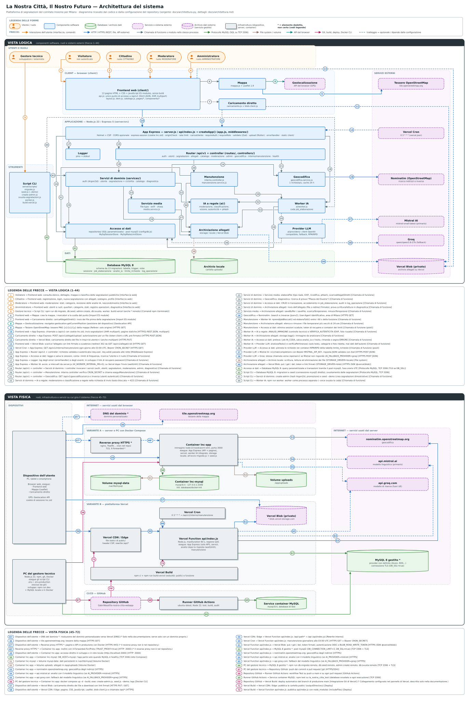

# Architettura di La Nostra Città

> File generato da [`architettura.py`](architettura.py) insieme a [`architettura.svg`](architettura.svg).
> Per modificarlo cambia i dati nello script ed esegui `python3 docs/architettura.py`.

Il diagramma ha due sezioni:

- **Vista logica** (frecce 1–44): componenti software, ruoli degli utenti e sistemi esterni.
- **Vista fisica** (frecce 45–72): dispositivi, container, piattaforme e servizi su cui girano i componenti, nelle due varianti di pubblicazione (Docker Compose e Vercel) più la CI.

Convenzioni: il colore di una freccia indica il meccanismo, il tratteggio indica un'interazione opzionale o che dipende dalla configurazione (per esempio `STORAGE_DRIVER`, `AI_PROVIDER`, la variante di deploy). L'asterisco `*` indica un elemento dedotto e non certo (vedi [Punti incerti](#punti-incerti)).

| Colore | Meccanismo |
|---|---|
| `#E8710A` | Interazione dell'utente (interfaccia, comandi) |
| `#1565C0` | HTTP / HTTPS (REST, file, API esterne) |
| `#546E7A` | Chiamata di funzione o modulo nello stesso processo |
| `#2E7D32` | Protocollo MySQL (SQL su TCP 3306) |
| `#8D6E63` | File system / volume |
| `#00897B` | API del browser |
| `#AD1457` | Git, build, deploy, Docker CLI |

## Frecce numerate

### Vista logica

| N. | Origine | Destinazione | Protocollo / meccanismo | Descrizione | File di riferimento |
|---:|---|---|---|---|---|
| 1 | Visitatore | Frontend web | Interfaccia web | consulta elenco, dettaglio, mappa e classifica delle segnalazioni pubbliche | `client/index.html`, `mappa.html`, `classifica.html`, `segnalazione.html` |
| 2 | Cittadino | Frontend web | Interfaccia web | registrazione, login, nuova segnalazione con allegati, sostegno, profilo | `client/registrazione.html`, `login.html`, `nuova-segnalazione.html`, `profilo.html` |
| 3 | Moderatore | Frontend web | Interfaccia web | moderazione: stati, categorie, revisione delle analisi IA, nascondi/mostra | `client/moderazione.html`, `client/js/pages/moderazione.js` |
| 4 | Amministratore | Frontend web | Interfaccia web | utenti e ruoli, quartieri, categorie, stati, registro operazioni, diagnostica | `client/admin.html`, `client/js/pages/admin.js` |
| 5 | Gestore tecnico | Script CLI | Comandi npm (terminale) | npm run db:migrate, db:seed, admin:create, db:svuota, worker, build:vercel (anche \*:remoto) | `package.json (scripts)`, `README.md` |
| 6 | Frontend web | Mappa | Import ES module | crea la mappa, i marcatori e la scelta del punto | `client/js/pages/mappa.js`, `client/js/pages/nuova-segnalazione.js`, `client/js/mappa.js` |
| 7 | Frontend web | Caricamento diretto | Import ES module | caricaAllegatiDiretti(): invio dei file prima della segnalazione *(opzionale / dipende dalla configurazione)* | `client/js/pages/nuova-segnalazione.js`, `client/js/caricamento.js` |
| 8 | Mappa | Geolocalizzazione | Geolocation API | navigator.geolocation.getCurrentPosition (posizione del dispositivo) | `client/js/mappa.js` |
| 9 | Mappa | Tessere OpenStreetMap | HTTPS GET | tessere PNG {z}/{x}/{y} della mappa (Referer: solo origine) | `client/js/mappa.js`, `server/src/config/csp.js`, `server/src/app.js` |
| 10 | Frontend web | App Express | HTTP(S) REST JSON, multipart | chiamate a /api/v1 con cookie lnc.sid; invio segnalazioni (XHR multipart); pagine statiche | `client/js/api.js`, `server/src/app.js` |
| 11 | Caricamento diretto | App Express | HTTPS POST JSON | POST /api/v1/allegati/upload: autorizzazione per un file (token client o URL pre-firmato) *(opzionale / dipende dalla configurazione)* | `client/js/caricamento.js`, `server/src/controllers/allegati.controller.js` |
| 12 | Caricamento diretto | Vercel Blob | HTTPS PUT | caricamento diretto del file in tmp/&lt;id utente>/ (anche multipart) *(opzionale / dipende dalla configurazione)* | `client/js/caricamento.js`, `server/scripts/blob-client.entry.js` |
| 13 | Frontend web | Vercel Blob | HTTPS GET | scarica l'allegato con link firmato a scadenza (redirect 302 da GET /api/v1/allegati/:id) *(opzionale / dipende dalla configurazione)* | `server/src/storage/blobStorage.js (send)`, `server/src/config/csp.js` |
| 14 | Vercel Cron | App Express | HTTPS GET | GET /api/v1/interno/manutenzione ogni giorno alle 03:00 UTC, Bearer CRON_SECRET *(opzionale / dipende dalla configurazione)* | `vercel.json (crons)`, `server/src/controllers/interno.controller.js` |
| 15 | App Express | Router /api/v1 + controller | Middleware Express | richiesta validata e autenticata (req.user, req.valid) passata alle rotte | `server/src/app.js`, `server/src/routes/index.js` |
| 16 | App Express | Accesso ai dati | Chiamata di funzione | legge e salva le sessioni, conta i limiti di frequenza, ricarica l'utente e il ruolo | `server/src/config/sessionStore.js`, `server/src/middlewares/security.js`, `server/src/middlewares/auth.js` |
| 17 | App Express | Logger | Chiamata di funzione | log degli errori (errorHandler) e degli eventi; in sviluppo il link di recupero password | `server/src/middlewares/errorHandler.js`, `server/src/controllers/auth.controller.js`, `server/src/utils/logger.js` |
| 18 | App Express | Worker IA | Chiamata di funzione | avvio: a intervalli da server.js (AI_WORKER_INTERVAL_MS>0); su Vercel dopo l'invio (waitUntil) | `server/src/server.js`, `server/src/controllers/segnalazione.controller.js`, `server/src/ai/worker.js` |
| 19 | Router /api/v1 + controller | Servizi di dominio | Chiamata di funzione | i controller invocano i servizi (auth, utenti, segnalazioni, moderazione, admin, diagnostica) | `server/src/controllers/*.js` |
| 20 | Router /api/v1 + controller | Manutenzione | Chiamata di funzione | interno.controller verifica CRON_SECRET e chiama eseguiManutenzione() | `server/src/routes/index.js`, `server/src/controllers/interno.controller.js` |
| 21 | Router /api/v1 + controller | Geocodifica | Chiamata di funzione | GET /api/v1/geocodifica/cerca e /inversa (utenti autenticati) | `server/src/routes/geocodifica.routes.js` |
| 22 | Servizi di dominio | IA a regole | Chiamata di funzione | moderazione e classificazione a regole nella richiesta di invio (testo bloccato → 422) | `server/src/services/segnalazione.service.js`, `server/src/ai/index.js` |
| 23 | Servizi di dominio | Servizio media | Chiamata di funzione | elaboraFile (tipo reale, EXIF, ricodifica, pHash), scaricaAllegatiDiretti | `server/src/services/segnalazione.service.js`, `server/src/services/media.service.js` |
| 24 | Servizi di dominio | Geocodifica | Chiamata di funzione | diagnostica: ricerca di prova ("Piazza del Duomo") | `server/src/services/diagnostica.service.js` |
| 25 | Servizi di dominio | Accesso ai dati | Chiamata di funzione | CRUD in transazione, accodamento in job_elaborazione, audit in log_operazione | `server/src/repositories/*.js`, `server/src/utils/audit.js` |
| 26 | Servizi di dominio | Archiviazione allegati | Chiamata di funzione | invio dell'allegato (file o redirect firmato); prova scrittura/lettura in diagnostica | `server/src/services/segnalazione.service.js`, `server/src/services/diagnostica.service.js` |
| 27 | Servizio media | Archiviazione allegati | Chiamata di funzione | saveBuffer / saveFile, scaricaTemporaneo, rimuoviTemporanei | `server/src/services/media.service.js` |
| 28 | Geocodifica | Nominatim | HTTPS GET | /search e /reverse (jsonv2), User-Agent identificativo, area di Milano | `server/src/services/geocodifica.service.js`, `.env.example (GEOCODING_*)` |
| 29 | Manutenzione | Worker IA | Chiamata di funzione | riprendiJobBloccati() ed elaboraTutti() entro i 60 s della funzione | `server/src/services/manutenzione.service.js` |
| 30 | Manutenzione | Archiviazione allegati | Chiamata di funzione | elenca e rimuove i file temporanei più vecchi di 24 ore | `server/src/services/manutenzione.service.js` |
| 31 | Manutenzione | Accesso ai dati | Chiamata di funzione (pool) | elimina sessioni scadute, token di recupero e contatori dei limiti | `server/src/services/manutenzione.service.js`, `server/src/config/rateLimitStore.js` |
| 32 | Worker IA | IA a regole | Chiamata di funzione | ANALISI_IMMAGINE (controllo tecnico) e VERIFICA_AUTENTICITA (EXIF, foto riusate) | `server/src/ai/worker.js`, `server/src/ai/visione.js`, `server/src/ai/autenticita.js` |
| 33 | Worker IA | Archiviazione allegati | Chiamata di funzione | storage.leggi(): immagine da analizzare | `server/src/ai/worker.js` |
| 34 | Worker IA | Accesso ai dati | Chiamata di funzione | preleva i job IN_CODA, salva analisi_ia e l'esito, rimanda o segna ERRORE | `server/src/ai/worker.js`, `server/src/repositories/analisi.repository.js` |
| 35 | Worker IA | Provider LLM | Chiamata di funzione | analizzaTesto() e verificaPertinenza() (solo testo, categorie e foto ridotta, mai dati dell'autore) *(opzionale / dipende dalla configurazione)* | `server/src/ai/worker.js`, `server/src/ai/providers/index.js` |
| 36 | Provider LLM | Accesso ai dati | Chiamata di funzione (pool) | prenota le richieste nei contatori RPM/RPD della tabella limite_richieste *(opzionale / dipende dalla configurazione)* | `server/src/ai/providers/limiti.js` |
| 37 | Provider LLM | Mistral AI | HTTPS POST JSON | /v1/chat/completions con Bearer MISTRAL_API_KEY, risposta JSON validata con Zod *(opzionale / dipende dalla configurazione)* | `server/src/ai/providers/openaiCompatibile.js`, `server/src/ai/providers/index.js` |
| 38 | Provider LLM | Groq | HTTPS POST JSON | stessa chiamata verso /openai/v1 se Mistral non risponde (AI_FALLBACK_PROVIDER=groq) *(opzionale / dipende dalla configurazione)* | `server/src/ai/providers/index.js`, `.env.example` |
| 39 | Archiviazione allegati | Archivio locale | File system | scrittura, lettura ed eliminazione dei file (STORAGE_DRIVER=locale) *(opzionale / dipende dalla configurazione)* | `server/src/storage/localStorage.js` |
| 40 | Archiviazione allegati | Vercel Blob | HTTPS (SDK @vercel/blob) | put / get / del, token e link firmati (STORAGE_DRIVER=blob) *(opzionale / dipende dalla configurazione)* | `server/src/storage/blobStorage.js` |
| 41 | Accesso ai dati | Database MySQL 8 | Protocollo MySQL, TCP 3306 (TLS se DB_SSL) | query parametrizzate e transazioni tramite il pool mysql2, fuso orario UTC | `server/src/config/db.js`, `server/src/config/dbOptions.js` |
| 42 | Script CLI | Database MySQL 8 | Protocollo MySQL, TCP 3306 | migrazioni e seed (connessione mysql2 diretta), svuotamento delle segnalazioni | `server/scripts/migrate.js`, `seed.js`, `svuota-segnalazioni.js` |
| 43 | Script CLI | Servizi di dominio | Chiamata di funzione | create-admin (hash Argon2id, promozione) e seed --demo (crea segnalazioni dimostrative) | `server/scripts/create-admin.js`, `server/scripts/seed.js` |
| 44 | Script CLI | Worker IA | Chiamata di funzione | npm run worker: worker come processo separato (--once svuota la coda) *(opzionale / dipende dalla configurazione)* | `server/scripts/worker.js` |

### Vista fisica

| N. | Origine | Destinazione | Protocollo / meccanismo | Descrizione | File di riferimento |
|---:|---|---|---|---|---|
| 45\* | Dispositivo dell'utente | DNS del dominio \* | DNS | risoluzione del dominio personalizzato verso Vercel *(opzionale / dipende dalla configurazione)* | `docs/CONFIGURAZIONE-MANUALE.md §9` |
| 46 | Dispositivo dell'utente | tile.openstreetmap.org | HTTPS GET | tessere della mappa | `client/js/mappa.js`, `vercel.json (CSP img-src)` |
| 47\* | Dispositivo dell'utente | Reverse proxy HTTPS \* | HTTPS 443 | pagine e API in produzione con Docker *(opzionale / dipende dalla configurazione)* | `README.md (Sicurezza e privacy`, `TRUST_PROXY)` |
| 48\* | Reverse proxy HTTPS \* | Container lnc-app | HTTP :3000 | inoltro con X-Forwarded-For/Proto (TRUST_PROXY=true) *(opzionale / dipende dalla configurazione)* | `README.md`, `.env.example (TRUST_PROXY)` |
| 49 | Dispositivo dell'utente | Container lnc-app | HTTP :3000 | accesso diretto in sviluppo o in rete locale (http://localhost:3000) | `docker-compose.yml (ports)`, `README.md` |
| 50 | Container lnc-app | Container lnc-mysql | TCP 3306 (rete Compose) | DB_HOST=mysql; l'app parte solo quando MySQL è healthy | `docker-compose.yml` |
| 51 | Container lnc-mysql | Volume mysql-data | Volume Docker | dati persistenti in /var/lib/mysql | `docker-compose.yml (volumes)` |
| 52 | Container lnc-app | Volume uploads | Volume Docker | allegati in /app/uploads | `docker-compose.yml`, `Dockerfile` |
| 53 | Container lnc-app | nominatim.openstreetmap.org | HTTPS | geocodifica degli indirizzi | `server/src/services/geocodifica.service.js` |
| 54 | Container lnc-app | api.mistral.ai | HTTPS | analisi con il modello linguistico (se AI_PROVIDER=mistral) *(opzionale / dipende dalla configurazione)* | `server/src/ai/providers/index.js` |
| 55 | Container lnc-app | api.groq.com | HTTPS | fallback del modello linguistico (se AI_FALLBACK_PROVIDER=groq) *(opzionale / dipende dalla configurazione)* | `server/src/ai/providers/index.js` |
| 56 | PC del gestore tecnico | Container lnc-app | Docker CLI | docker compose up -d --build; exec create-admin.js, seed.js --demo; logs | `README.md (Opzione A)`, `docker-compose.yml` |
| 57 | Dispositivo dell'utente | Vercel Blob | HTTPS PUT / GET | caricamento diretto dei file e download con link firmati | `client/js/caricamento.js`, `vercel.json (CSP connect-src`, `img-src)` |
| 58 | Dispositivo dell'utente | Vercel CDN / Edge | HTTPS | pagine, CSS, JavaScript, Leaflet, blob-client.js e chiamate /api/\* | `vercel.json`, `server/scripts/build-vercel.js` |
| 59 | Vercel CDN / Edge | Vercel Function api/index.js | Rewrite interno | /api/:path\* → /api (api/index.js) | `vercel.json (rewrites)`, `api/index.js` |
| 60 | Vercel Cron | Vercel Function api/index.js | HTTPS GET + Bearer CRON_SECRET | manutenzione giornaliera alle 03:00 UTC | `vercel.json (crons)` |
| 61 | Vercel Function api/index.js | Vercel Blob | HTTPS (SDK @vercel/blob) | put / get / del, token firmati; autenticazione OIDC o BLOB_READ_WRITE_TOKEN | `server/src/storage/blobStorage.js`, `server/tests/vercelOidc.test.js` |
| 62 | Vercel Function api/index.js | MySQL 8 gestito \* | TCP 3306 + TLS | pool mysql2 (DB_CONNECTION_LIMIT=3, DB_SSL=true) | `.env.production.example`, `server/src/config/dbOptions.js` |
| 63 | Vercel Function api/index.js | nominatim.openstreetmap.org | HTTPS | geocodifica degli indirizzi | `server/src/services/geocodifica.service.js` |
| 64 | Vercel Function api/index.js | api.mistral.ai | HTTPS | analisi con il modello linguistico (se AI_PROVIDER=mistral) *(opzionale / dipende dalla configurazione)* | `server/src/ai/providers/index.js` |
| 65 | Vercel Function api/index.js | api.groq.com | HTTPS | fallback del modello linguistico (se AI_FALLBACK_PROVIDER=groq) *(opzionale / dipende dalla configurazione)* | `server/src/ai/providers/index.js` |
| 66 | PC del gestore tecnico | MySQL 8 gestito \* | TCP 3306 + TLS | npm run db:migrate:remoto, db:seed:remoto, admin:create:remoto, db:svuota:remoto | `package.json`, `.env.production.example`, `DEPLOY-VERCEL.md §3` |
| 67 | PC del gestore tecnico | Repository GitHub | git (HTTPS/SSH) | push dei commit e pull request | `README.md`, `docs/CONFIGURAZIONE-MANUALE.md §4` |
| 68 | Repository GitHub | Runner GitHub Actions | GitHub Actions | workflow Test su push a main e su ogni pull request | `.github/workflows/test.yml` |
| 69 | Runner GitHub Actions | Service container MySQL | TCP 3306 | npm test su la_nostra_citta_test (database svuotato a ogni esecuzione) | `.github/workflows/test.yml` |
| 70\* | Repository GitHub | Vercel Build | Integrazione Git di Vercel | deploy automatico del branch di produzione main | `DEPLOY-VERCEL.md §4`, `docs/CONFIGURAZIONE-MANUALE.md §4` |
| 71 | Vercel Build | Vercel CDN / Edge | Deploy | pubblica la cartella public/ (outputDirectory) | `vercel.json`, `server/scripts/build-vercel.js` |
| 72 | Vercel Build | Vercel Function api/index.js | Deploy | pubblica api/index.js con node_modules (includeFiles) | `vercel.json (functions)` |

## Attori

### Attori logici

| Attore | Tipo | Descrizione | Dove viene eseguito / si trova |
|---|---|---|---|
| Gestore tecnico | Utente / ruolo | Chi installa, configura e pubblica la piattaforma; esegue gli script di manutenzione del database. | PC del gestore |
| Visitatore | Utente / ruolo | Consulta segnalazioni pubbliche, mappa e classifica senza account. | Dispositivo dell'utente |
| Cittadino | Utente / ruolo | Utente registrato: invia segnalazioni con allegati, sostiene quelle degli altri, gestisce il profilo. | Dispositivo dell'utente |
| Moderatore | Utente / ruolo | Volontario del comitato: verifica le segnalazioni, cambia stato e categorie, rivede le analisi IA. | Dispositivo dell'utente |
| Amministratore | Utente / ruolo | Gestisce utenti e ruoli, quartieri, categorie, stati, registro operazioni e diagnostica. | Dispositivo dell'utente |
| Frontend web (client/) | Componente software | Interfaccia della piattaforma: una pagina per funzione, controllo accessi lato client, tutte le chiamate all'API passano da api.js. | Browser dell'utente (file serviti da Express o dalla CDN di Vercel) |
| Mappa | Componente software | Mappa delle segnalazioni e scelta del punto (Leaflet, servito da /vendor/leaflet). | Browser dell'utente |
| Caricamento diretto | Componente software | Carica foto e video dal browser direttamente su Vercel Blob (le richieste a una funzione Vercel non possono superare 4,5 MB). blob-client.js è @vercel/blob/client impacchettato da esbuild. | Browser dell'utente (solo con archivio Vercel Blob) |
| Geolocalizzazione | Servizio o sistema esterno | navigator.geolocation: posizione del dispositivo per centrare la mappa e scegliere il punto. | Dispositivo dell'utente |
| App Express — server.js / api/index.js → createApp() (app.js, middlewares/) | Componente software | Processo Node che crea l'app Express e applica i middleware di sicurezza; fuori da Vercel serve anche le pagine statiche e avvia il worker IA a intervalli. | Container lnc-app / processo Node locale, oppure Vercel Function |
| Logger | Componente software | Log strutturati JSON (pino) su stdout; in sviluppo contiene il link di recupero password. | Stesso processo dell'app; i log finiscono nei log del container o di Vercel |
| Router /api/v1 + controller (routes/, controllers/) | Componente software | Instradamento REST e controller: leggono la richiesta validata, chiamano i servizi, formattano la risposta. | Come App Express |
| Servizi di dominio (services/) | Componente software | Regole di business: registrazione e login, macchina a stati delle segnalazioni, sostegni, moderazione, catalogo, controlli di diagnostica. | Come App Express |
| Manutenzione | Componente software | Pulizia periodica (sessioni, token, limiti, file temporanei) e ripresa delle analisi in coda. | Vercel Function (invocata dal cron) |
| Geocodifica | Componente software | Ricerca di indirizzi e geocodifica inversa tramite Nominatim, in coda e con cache in memoria. | Come App Express |
| IA a regole (ai/) | Componente software | Analisi deterministiche senza servizi esterni: parole vietate, parole chiave, controllo tecnico delle immagini, EXIF e foto già usate (hash percettivo). | Come App Express |
| Servizio media | Componente software | Verifica dei magic bytes, lettura EXIF/GPS, ricodifica delle immagini senza metadati, hash percettivo. | Come App Express |
| Archiviazione allegati | Componente software | Interfaccia unica per gli allegati con due implementazioni: disco locale (uploads/) o Vercel Blob privato. | Come App Express |
| Worker IA | Componente software | Esegue le analisi lente fuori dalla richiesta: a intervalli nel server, come processo separato o dopo la risposta su Vercel (waitUntil). Non cambia mai lo stato delle segnalazioni. | Container lnc-app / processo separato / Vercel Function |
| Accesso ai dati | Componente software | Unico punto di accesso a MySQL: repository con query parametrizzate, store delle sessioni e dei contatori dei limiti di frequenza. | Come App Express |
| Provider LLM | Componente software | Client HTTP verso i modelli linguistici (formato OpenAI), con catena primario → fallback, nuovi tentativi e limiti di richieste condivisi nel database. Attivo solo con AI_PROVIDER=mistral. | Come Worker IA |
| Script CLI | Componente software | Comandi npm per migrazioni, dati iniziali e dimostrativi, primo amministratore, svuotamento, worker separato e generazione dei file statici per Vercel. | PC del gestore, container lnc-app (docker compose exec) o Vercel Build (build-vercel.js) |
| Database MySQL 8 | Database / archivio dati | MySQL ≥ 8.0.19 (InnoDB, utf8mb4): dati applicativi, sessioni, coda delle analisi, contatori dei limiti, registro delle operazioni. | Container lnc-mysql, MySQL locale o MySQL 8 gestito in cloud |
| Archivio locale | Database / archivio dati | Allegati salvati su disco con nomi casuali AAAA/MM/uuid.ext. | Volume uploads del container lnc-app o disco del server |
| Tessere OpenStreetMap | Servizio o sistema esterno | Immagini della mappa caricate dal browser. | Internet |
| Vercel Cron | Servizio o sistema esterno | Pianificatore di Vercel che invoca la manutenzione una volta al giorno. | Piattaforma Vercel |
| Nominatim (OpenStreetMap) | Servizio o sistema esterno | Servizio gratuito di geocodifica (nominatim.openstreetmap.org), chiamato solo dal server. | Internet |
| Mistral AI | Servizio o sistema esterno | Modello linguistico principale (API compatibile OpenAI), azienda con sede nell'UE. | Internet |
| Groq | Servizio o sistema esterno | Fornitore di riserva facoltativo (AI_FALLBACK_PROVIDER=groq); tratta i dati negli USA. | Internet |
| Vercel Blob (privato) | Archivio dati esterno (servizio gestito) | Object storage privato: file temporanei tmp/&lt;id utente>/ e definitivi AAAA/MM/uuid.ext, letti dal browser con link firmati a scadenza. | Piattaforma Vercel |

### Attori fisici

| Attore | Tipo | Descrizione |
|---|---|---|
| DNS del dominio \* | Servizio o sistema esterno | Record DNS del dominio proprio che puntano a Vercel; HTTPS gestito da Vercel. (dominio personalizzato) |
| tile.openstreetmap.org | Servizio o sistema esterno | Server delle tessere di OpenStreetMap. (tessere della mappa) |
| Dispositivo dell'utente | Infrastruttura (dispositivo, server, container) | Dispositivo di visitatori, cittadini, moderatori e amministratori; il browser esegue il frontend. (PC, tablet o smartphone · Browser web, esegue: · · Frontend web · · Mappa (Leaflet) · · Caricamento diretto · GPS: Geolocation API · cookie di sessione lnc.sid) |
| PC del gestore tecnico | Infrastruttura (dispositivo, server, container) | Computer da cui si sviluppa, si avvia Docker Compose, si inizializza il database remoto e si pubblica il codice. (Node.js 22, npm, git, Docker · esegue gli script CLI · .env / .env.production · (esclusi da git) · sviluppo: npm run dev · + MySQL locale o in Docker) |
| Reverse proxy HTTPS \* | Infrastruttura (dispositivo, server, container) | Termina HTTPS davanti al container in produzione (cookie Secure, HSTS, TRUST_PROXY=true). (nginx, Traefik… (non nel repo) · TLS, X-Forwarded-\*) |
| Container lnc-app | Infrastruttura (dispositivo, server, container) | Container costruito dal Dockerfile (utente node); esegue tutta l'applicazione Node. (immagine node:22-bookworm-slim, porta 3000 · esegue: App Express (API + pagine), · servizi, worker IA integrato, storage · locale; all'avvio migrate.js + seed.js) |
| Container lnc-mysql | Database / archivio dati | MySQL 8.4 del docker-compose.yml; al primo avvio crea anche il database di test. (mysql:8.4 · 127.0.0.1:3306 · init: database/docker-init) |
| Volume mysql-data | Database / archivio dati | Volume Docker con i file del database. (/var/lib/mysql) |
| Volume uploads | Database / archivio dati | Volume Docker con gli allegati (archivio locale). (/app/uploads) |
| Vercel Cron | Infrastruttura (dispositivo, server, container) | Pianificatore di Vercel definito in vercel.json. (0 3 \* \* \* → /api/v1/interno/manutenzione) |
| Vercel Blob (privato) | Archivio dati esterno (servizio gestito) | Store Blob in modalità privata collegato al progetto (variabili BLOB_\*). (\*.blob.vercel-storage.com) |
| Vercel CDN / Edge | Infrastruttura (dispositivo, server, container) | Rete di distribuzione di Vercel: serve le pagine e applica headers e rewrites di vercel.json. (file statici di public/ · header CSP, rewrite /api/\*) |
| Vercel Function api/index.js | Infrastruttura (dispositivo, server, container) | Funzione serverless che esegue la stessa app Express; regione predefinita iad1 (modificabile dal pannello Vercel). (Node.js, maxDuration 60 s, regione iad1 · esegue: App Express (solo API), servizi, · analisi dopo la risposta (waitUntil), · manutenzione) |
| Vercel Build | Infrastruttura (dispositivo, server, container) | Fase di build di Vercel: installa le dipendenze e genera la cartella public/. (npm ci + npm run build:vercel (esbuild): public/ e funzione) |
| Repository GitHub | Servizio o sistema esterno | Repository del codice sorgente. (GabriWasef/la-nostra-citta-webapp) |
| Runner GitHub Actions | Infrastruttura (dispositivo, server, container) | Job "Test" del workflow .github/workflows/test.yml. (ubuntu-latest, Node 22: test, build, audit) |
| Service container MySQL | Database / archivio dati | MySQL usa e getta del job CI. (mysql:8.4, database di test) |
| nominatim.openstreetmap.org | Servizio o sistema esterno | Servizio Nominatim di OpenStreetMap. (geocodifica) |
| api.mistral.ai | Servizio o sistema esterno | API di Mistral AI. (modello linguistico (primario)) |
| api.groq.com | Servizio o sistema esterno | API di Groq, compatibile OpenAI. (modello di riserva (fuori UE)) |
| MySQL 8 gestito \* | Database / archivio dati | Database MySQL ≥ 8.0.19 raggiungibile da internet, usato dalla variante Vercel. (provider non definito (Aiven, RDS…) · connessione TLS (DB_SSL=true)) |

## Punti incerti

Elementi marcati con `*` nel diagramma: risultano dalla documentazione del repository ma non dal codice o dalla configurazione, oppure dipendono da scelte fatte fuori dal repository.

- **DNS del dominio \*** (attore): Presente solo nella documentazione (CONFIGURAZIONE-MANUALE.md §9), opzionale: senza dominio proprio si usa l'indirizzo \*.vercel.app.
- **Reverse proxy HTTPS \*** (attore): Raccomandato dal README (sezione Sicurezza e privacy) ma non configurato nel repository: tipo e posizione sono ipotetici.
- **MySQL 8 gestito \*** (attore): Il repository non indica il provider: DEPLOY-VERCEL.md elenca solo esempi (Aiven, DigitalOcean, RDS, Cloud SQL, Azure).
- **Freccia 45\*** (Dispositivo dell'utente → DNS del dominio \*): Solo nella documentazione; serve solo con un dominio proprio.
- **Freccia 47\*** (Dispositivo dell'utente → Reverse proxy HTTPS \*): Il reverse proxy non è nel repository.
- **Freccia 48\*** (Reverse proxy HTTPS \* → Container lnc-app): Il reverse proxy non è nel repository.
- **Freccia 70\*** (Repository GitHub → Vercel Build): Collegamento configurato nel pannello di Vercel, descritto solo nella documentazione.

Altre note, non marcate con `*` perché la parte certa è nel codice:

- **Autenticazione OIDC verso Vercel Blob** (freccia 61): con uno store OIDC (`BLOB_STORE_ID`) lo scambio del token con l'API di Vercel avviene dentro l'SDK `@vercel/blob`/`@vercel/oidc`; il repository lo mostra solo nel test `server/tests/vercelOidc.test.js`.
- **Regione della funzione Vercel**: `iad1` è il valore predefinito citato in `DEPLOY-VERCEL.md`; la regione reale si sceglie nel pannello di Vercel (consigliata una regione europea).
- **Invio di e-mail**: non esiste un servizio SMTP. Il link di recupero password viene scritto nel log solo in sviluppo (`server/src/controllers/auth.controller.js`); in produzione non viene inviato.
- **Antivirus**: `scansionaFile()` in `server/src/storage/index.js` è un punto di aggancio non collegato a nessun servizio, quindi non compare nel diagramma.
- **Video**: non vengono ricodificati né analizzati dall'IA (serve ffmpeg, non presente).
- **Servizi esterni condizionali**: Mistral e Groq sono contattati solo con `AI_PROVIDER=mistral` (Groq solo con `AI_FALLBACK_PROVIDER=groq`); Vercel Blob solo con lo store collegato (`STORAGE_DRIVER=blob`); Nominatim si disattiva con `GEOCODING_ENABLED=false`.

## Riepilogo

- Attori logici: 30
- Attori fisici: 21
- Frecce: 72 (44 nella vista logica, 28 nella vista fisica)
